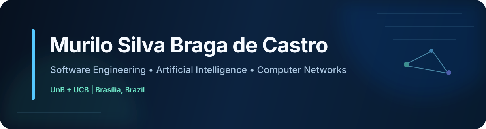

<p align="center">
  
</p>

<p align="center">
  <a href="https://www.linkedin.com/in/murilocastro31/"></a>
  <a href="mailto:murilosbcastro@gmail.com"></a>
  
  <a href="#portfolio"></a>
</p>

## About me

I’m a technology student based in **Brasília, Brazil**, currently pursuing two higher-education programs:

- **Communication Networks Engineering** at **Universidade de Brasília (UnB)** — expected graduation: **2031**
- **Systems Analysis and Development** at **Universidade Católica de Brasília (UCB)** — expected graduation: **2028**

My main interests are **Software Engineering, Artificial Intelligence and Computer Networks**. I enjoy learning through practice: testing ideas, understanding why things fail, correcting mistakes and improving solutions until they work well.

Right now, I’m strengthening my programming fundamentals, learning modern development workflows and building a [portfolio](#portfolio) of real-world projects while pursuing my **first internship in technology**.

## Current focus

```text
Software Engineering    → programming fundamentals, full stack development, clean code
Artificial Intelligence → generative AI, LLM workflows, AI-assisted development
Computer Networks       → networking fundamentals, infrastructure and automation
Career                   → first internship in technology
```

## Portfolio

### Featured projects

> 🔒 The source code of these three projects is kept in private repositories. I’m happy to walk through the code, architecture and tests in an interview.

<table>
<tr>
<td width="50%" valign="top">

#### 🎲 Grimório da Mesa

**Online platform for tabletop RPG campaigns** — a fan-made, non-profit platform for *Black Clover* campaigns using the *Feiticeiros & Maldições* system.

- Character sheets with a fully tested **rules engine** that calculates attributes, skills, defense, damage and level progression automatically
- Game masters can **customize the rules** of each campaign and preview the impact before applying
- **Server-side dice rolls**, real-time combat, chat with roll commands and a **2D virtual tabletop** (scenes, grid, tokens, fog of war)
- Security by design: **Row Level Security on every table**, private file storage served through short-lived signed URLs
- **178 unit and database tests** (Vitest + PGlite) and Playwright end-to-end tests


**Status:** in development · 🔒 private repository

</td>
<td width="50%" valign="top">

#### 🏋️ Carga

**Mobile-first strength training log** — replaces spreadsheets, notes, a separate timer and manual progression math with a single app, built to be used at the gym.

- **Local-first active workout** stored in IndexedDB with a sync queue, so logging keeps working with a bad connection
- Load **progression suggestions** with explanations, estimated 1RM, personal-record detection and a plate calculator
- Routines, history with calendar, progress charts, body measurements, goals and **private progress photos**
- Supabase backend with **Row Level Security** and an **email allowlist** (no public sign-up)
- Versioned **JSON backup** with import preview; catalog of 73 exercises


**Status:** functional end to end · 🔒 private

</td>
</tr>
<tr>
<td colspan="2" valign="top">

#### ⚖️ Medeiros & Antinoro — Institutional website

**Website for a law firm** (client project), focused on accessibility, a consistent visual identity and maintainable code.

- Custom **design system** with semantic tokens and WCAG-checked color contrast, documented alongside UX and security contracts
- Responsive pages for the firm, practice areas and contact, including partner profiles and FAQ
- **Instagram feed** fetched server-side (no keys exposed to the browser), with caching tuned to stay within the free plan’s limits
- **Accessibility tested automatically** with Playwright + axe-core: keyboard navigation, reflow and reduced motion
- **CI on GitHub Actions** (format, typecheck, lint, tests and build) and architecture decisions recorded as ADRs


**Status:** in development, content under client review · 🔒 private repository

</td>
</tr>
</table>

### Challenges and practice

| Project | What it is | Stack | Code |
|---|---|---|---|
| **Algorithms in JavaScript** | Trainee challenge: the 5 final projects of freeCodeCamp’s *JavaScript Algorithms and Data Structures* (palindrome checker and more) | JavaScript | [Repository](https://github.com/MuriloCastro-UnB/Desafio-1-2024.1-Backend) |
| **Web résumé** | Trainee challenge: a personal résumé built as a web page using only HTML and CSS, without CSS frameworks | HTML, CSS | [Repository](https://github.com/MuriloCastro-UnB/Desafio-1-2024.1-Frontend) |

## Tech stack

### Languages

<p>
  
</p>

### Web Development

<p>
  
</p>

### Tools & Platforms

<p>
  
</p>

> Technologies listed here are technologies I have already studied or used. I’m actively developing deeper proficiency through coursework and hands-on practice.

## Education

### Universidade de Brasília — UnB
**Communication Networks Engineering**  
2026 — 2031 (expected)

Current coursework includes **Computer Programming for Engineering, Calculus I, Physics I, Experimental Physics I and Environmental Sciences**.

### Universidade Católica de Brasília — UCB
**Technology Degree in Systems Analysis and Development**  
2026 — 2028 (expected)

## Additional training

### FullStack PRO — Sujeito Programador
**In progress — started Jan 2026**

Training focused on modern full stack development, covering front-end, back-end and AI-assisted software development.

## Certifications

All issued by **Anthropic** through **Claude Academy** in **August 2026**.

| Certification | Credential ID |
|---|---|
| **Claude 101** | `12b2742b14a00a7349a6a74340bcd968` |
| **AI Fluency: Framework & Foundations** | `f3960a3c6bd558c37861c2c8fc0286c6` |
| **AI Capabilities and Limitations** | `0e6cdffbb706554c332bc309f591ca79` |
| **Claude Code 101** | `66fb73940865a129a99dc0d83319a410` |
| **Introduction to Claude Cowork** | `299a05412770578f5e040c2a86c59212` |

## Technical roadmap

Next projects and technical areas I plan to develop as my portfolio grows:

| Project / Track | Goal | Planned stack |
|---|---|---|
| **NetDiag** | Network diagnostics and automation | Python, networking, CLI |
| **Full Stack Application** | End-to-end web application | React / Next.js, Node.js, database |
| **NetOps AI** | AI-assisted network and infrastructure analysis | Python / TypeScript, LLM API, full stack |
| **Algorithms & Data Structures** | Problem solving and interview fundamentals | Python / C++ |

> This section is a roadmap, not a list of completed projects. Finished work is listed in the [Portfolio](#portfolio) section.

## What I’m learning next

- Git and collaborative development workflows
- SQL and relational databases
- REST APIs and HTTP fundamentals
- Data structures and algorithms
- Linux and command-line tooling
- TCP/IP, DNS, routing, switching and network fundamentals
- Building and documenting production-style projects

## Languages

- **Portuguese:** Native
- **English:** Intermediate
- **Spanish:** Intermediate

## Let’s connect

I’m looking for my **first technology internship**, preferably remote, while remaining open to on-site opportunities.

If you work with **software engineering, AI, networking, infrastructure or technology recruiting**, feel free to reach out.

<p align="center">
  <a href="https://www.linkedin.com/in/murilocastro31/"><strong>LinkedIn</strong></a>
  ·
  <a href="mailto:murilosbcastro@gmail.com"><strong>Email</strong></a>
</p>
